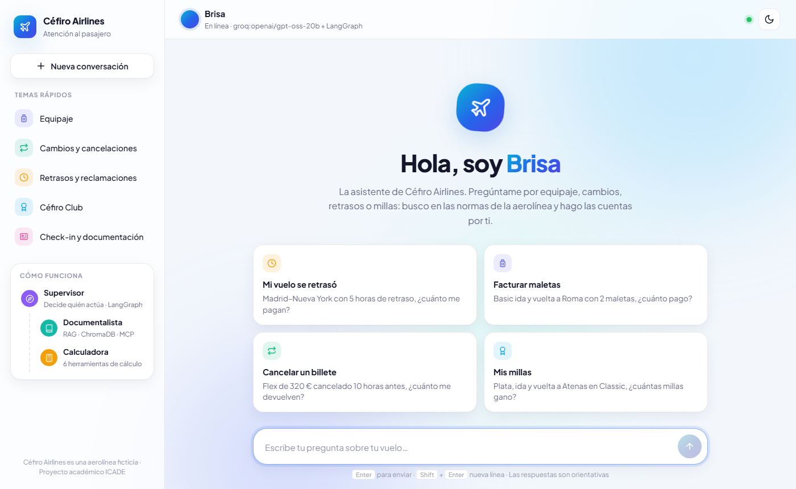
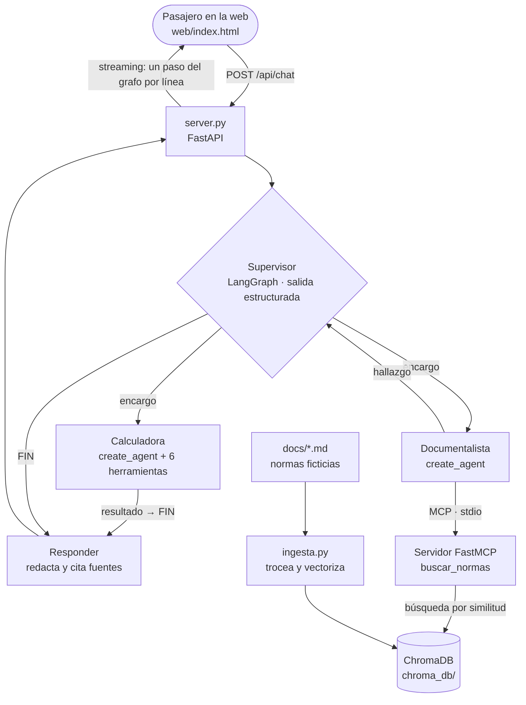
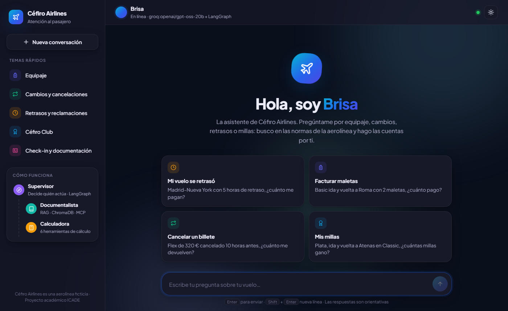

# Brisa · Asistente de Céfiro Airlines con LangChain + LangGraph + RAG (ChromaDB) + MCP (FastMCP)

Proyecto de la asignatura **Deep Learning** (E2+Analytics 4.1, ICADE · Universidad Pontificia Comillas).

Una **página web** cuyo producto principal es **Brisa**, la asistente virtual de **Céfiro Airlines**,
una aerolínea **ficticia** con base en Madrid. Los pasajeros le preguntan por equipaje, cambios y
cancelaciones, retrasos, millas o documentación, y Brisa responde **basándose en las normas de la
aerolínea** (RAG) y **haciendo las cuentas** con herramientas cuando hace falta.

Sigue la arquitectura del manual de clase *«Agentes con LangChain y LangGraph. RAG con ChromaDB y MCP
con FastMCP»*, que construye un asistente para una asignatura. Aquí se aplica a otro caso de uso
(atención al pasajero de una aerolínea) y se le añade una interfaz web.



**Tecnologías:** Python · LangChain · LangGraph · ChromaDB · FastMCP · fastembed · FastAPI · Groq · HTML/CSS/JS

---

## 1. Qué hace

Un **supervisor** (LangGraph) reparte cada pregunta entre dos agentes especialistas:

| Agente | Qué hace | Herramientas |
|---|---|---|
| **Documentalista** | Busca en las normas de la aerolínea con RAG sobre ChromaDB, **a través de un servidor MCP** hecho con FastMCP | `buscar_normas` (MCP) |
| **Calculadora** | Hace las cuentas con las reglas que encuentra el documentalista | `coste_equipaje`, `compensacion_retraso`, `reembolso_cancelacion`, `coste_cambio_vuelo`, `millas_ganadas`, `horas_entre` |

Las herramientas de cálculo **no llevan las reglas escritas en el código** (precios de maletas,
importes de compensación, porcentajes de reembolso, coeficientes de millas): las reciben como
parámetros. Así, igual que en el manual, el cálculo **depende de lo que digan las normas**, y el
RAG es imprescindible.

**Pregunta de ejemplo que necesita a los dos:** *«Mi vuelo Madrid–Nueva York llegó con 5 horas de
retraso por una avería, ¿cuánto me corresponde?»*
1. Supervisor → **documentalista**: busca la distancia Madrid–Nueva York (5.768 km) y la tabla de compensaciones (250 / 400 / 600 € según distancia, a partir de 3 h).
2. Supervisor → **calculadora**: `compensacion_retraso(5768, 5, 3, 1500, 3500, 250, 400, 600)` → **600 €**.
3. **Responder** redacta la respuesta citando `retrasos_y_reclamaciones.md` y `rutas_y_cefiro_club.md`.

### Preguntas de ejemplo (probadas)

| Pregunta | Agentes | Respuesta |
|---|---|---|
| Madrid–Nueva York con 5 h de retraso por avería, ¿cuánto me pagan? | Documentalista + Calculadora | **600 €** |
| Basic ida y vuelta a Roma con 2 maletas de 23 kg compradas en la web, ¿cuánto pago? | Documentalista + Calculadora | **140 €** (2 × 35 € × 2 trayectos) |
| Flex de 320 € (275 € tarifa + 45 € tasas) cancelado 10 h antes, ¿cuánto me devuelven? | Documentalista + Calculadora | **265 €** (80 % de la tarifa + tasas) |
| Nivel Plata, ida y vuelta Madrid–Atenas en Classic, ¿cuántas millas gano? | Documentalista + Calculadora | **2.966 millas** |
| ¿Qué documentación necesito para volar a Nueva York? | Solo documentalista | Pasaporte + ESTA |

## 2. Arquitectura



**Flujo del grafo (LangGraph):** `INICIO → supervisor → (documentalista | calculadora) → supervisor → … → responder → FIN`.

| Elemento | En este proyecto |
|---|---|
| LLM | **Groq** con `openai/gpt-oss-120b` (o `gpt-oss-20b`), plan gratuito · `app/config.py` |
| Embeddings | `paraphrase-multilingual-MiniLM-L12-v2` en local con **fastembed** |
| Troceado | Por apartados Markdown (`##`) y después ≈500 caracteres con 50 de solape |
| Base vectorial | **ChromaDB** persistida en `chroma_db/` |
| Servidor MCP | **FastMCP**, herramienta `buscar_normas`, transporte `stdio` |
| Cliente MCP | `MultiServerMCPClient` de `langchain-mcp-adapters` |
| Agentes | `create_agent` de LangChain · `app/agentes.py` |
| Orquestación | `StateGraph` con arista condicional · `app/grafo.py` |
| Estado | `messages`, `siguiente`, `tarea`, `hallazgos` (se acumulan con `operator.add`), `necesita_calculo` |
| Backend web | **FastAPI**: abre una sesión MCP al arrancar y emite cada paso del grafo en streaming |
| Frontend | HTML + CSS + JS sin frameworks: muestra en directo qué agente está trabajando |

### Cambios respecto al manual
- **Caso de uso**: atención al pasajero de una aerolínea ficticia en lugar de una asignatura.
- **Interfaz web** (`server.py` + `web/`) además de la consola (`main.py`).
- **Historial**: la web envía los últimos turnos, así se entienden preguntas de seguimiento.
- **Sesión MCP persistente** en el servidor web: el proceso FastMCP se arranca una sola vez.
- **Ingesta**: trocea por apartados de Markdown (cada fragmento lleva el título de su apartado) y vacía la colección antes de reindexar.
- **Salvaguardas en el grafo**:
  - El supervisor indica en su primera decisión si la pregunta necesita un cálculo (`necesita_calculo`); si intenta terminar sin la calculadora, el grafo la llama igualmente.
  - Cuando la calculadora da un resultado, se pasa directamente a redactar la respuesta.
  - Cada especialista actúa como mucho 2 veces (`MAX_POR_AGENTE`) y hay un máximo de 4 pasos (`MAX_PASOS`).
- **El documentalista no calcula**: solo devuelve reglas y cifras; las cuentas las hace siempre la calculadora con sus herramientas (el LLM se equivoca haciendo cuentas a mano).

## 3. Estructura

```
├── docs/                         # normas inventadas de la aerolínea (RAG)
│   ├── tarifas_y_equipaje.md
│   ├── cambios_y_cancelaciones.md
│   ├── retrasos_y_reclamaciones.md
│   ├── rutas_y_cefiro_club.md    # distancias y programa de millas
│   └── preguntas_frecuentes.md
├── app/
│   ├── __init__.py
│   ├── config.py                 # rutas, LLM y embeddings
│   ├── ingesta.py                # RAG: documentos -> ChromaDB
│   ├── servidor_mcp.py           # servidor MCP con FastMCP
│   ├── herramientas.py           # 6 herramientas de la calculadora
│   ├── agentes.py                # documentalista y calculadora
│   └── grafo.py                  # orquestación con LangGraph
├── web/
│   ├── index.html                # la página del chatbot
│   ├── styles.css
│   └── app.js
├── assets/                       # capturas para este README
├── server.py                     # API FastAPI + sirve la web
├── main.py                       # probar el grafo desde consola
├── probar_mcp.py                 # probar el servidor MCP solo
├── requirements.txt
├── .env.example                  # copia a .env y pon tu clave
└── README.md
```

## 4. Puesta en marcha

Necesitas **Python 3.10 o superior** y una **clave gratuita de Groq** (https://console.groq.com/keys, no pide tarjeta).

```bash
# 1. Entorno e instalación
python -m venv .venv
.venv\Scripts\activate                 # Windows  (macOS/Linux: source .venv/bin/activate)
pip install -r requirements.txt

# 2. Clave del modelo: copia .env.example a .env y pon tu clave de Groq (empieza por gsk_)
copy .env.example .env                 # Windows  (macOS/Linux: cp .env.example .env)

# 3. Ingesta: crea chroma_db/ (la primera vez descarga ~220 MB de embeddings)
python -m app.ingesta

# 4. Pruebas por partes
python probar_mcp.py "¿Cuánto cuesta facturar una bicicleta?"
python main.py "Mi vuelo Madrid–Nueva York llegó con 5 horas de retraso, ¿cuánto me pagan?"

# 5. La web
python server.py                       # y abre http://127.0.0.1:8000
```

> **Windows:** arranca la web con `python server.py`, no con `uvicorn --reload`: el modo *reload* usa
> en Windows un bucle de eventos que no puede lanzar el proceso del servidor MCP.
>
> **Puerto ocupado:** añade `PUERTO=8001` (u otro) al `.env`.

## 5. La web

- **Pantalla de bienvenida** con cuatro preguntas de ejemplo y **temas rápidos** en la barra lateral.
- **Proceso en directo**: mientras responde se ve cada paso del grafo (Supervisor → Documentalista →
  Calculadora → Respuesta), con el encargo de cada agente y lo que ha encontrado; después se pliega
  en «Ver cómo lo he resuelto».
- El diagrama **«Cómo funciona»** de la barra lateral ilumina el agente que está trabajando.
- **Fuentes** citadas como etiquetas bajo cada respuesta y botón de **copiar**.
- **Modo claro/oscuro**, diseño adaptable a móvil e indicador de estado del backend.



## 6. Problemas frecuentes

| Síntoma | Solución |
|---|---|
| La web dice «Falta GROQ_API_KEY» | Crea `.env` a partir de `.env.example`, pon tu clave y reinicia `python server.py` |
| «Se ha agotado el límite DIARIO» | El plan gratuito de Groq da unos 200.000 tokens al día por modelo. Cambia `MODELO=groq:openai/gpt-oss-20b` en `.env` (tiene su propio límite) o espera |
| Error 429 / límite por minuto | Espera unos segundos: el plan gratuito limita los tokens por minuto |
| Error 404 `model_not_found` | Groq retira modelos: mira los disponibles en console.groq.com y cambia `MODELO` en `.env` |
| La web dice «No existe chroma_db/» | Ejecuta `python -m app.ingesta` |
| `NotImplementedError` al arrancar en Windows | No uses `uvicorn --reload`; usa `python server.py` |
| `Connection closed` al cargar herramientas MCP | Ejecuta `python -m app.servidor_mcp` a mano para ver el error |
| Conflicto de versiones de `mcp` | Mantén `fastmcp>=3.0,<4.0` |

## 7. Subir este proyecto a tu propio GitHub

Si has recibido el proyecto en un **zip**:

1. Descomprímelo en una carpeta.
2. En GitHub, crea un repositorio nuevo y **vacío** (https://github.com/new, sin marcar «Add a README»).
3. Abre una terminal en la carpeta del proyecto y ejecuta (cambiando la URL por la de tu repositorio):

```bash
git init -b main
git add .
git commit -m "Asistente de Céfiro Airlines con LangGraph, RAG y MCP"
git remote add origin https://github.com/TU_USUARIO/TU_REPOSITORIO.git
git push -u origin main
```

El `.gitignore` ya evita que se suban la clave (`.env`), la base vectorial (`chroma_db/`) y el entorno
virtual (`.venv/`). **Nunca subas tu `.env`**: cada persona usa su propia clave de Groq.

Alternativa sin terminal: en el repositorio vacío de GitHub, «uploading an existing file», y arrastra
el **contenido** de la carpeta (no la carpeta entera, para que el README quede en la raíz).

## 8. Usar el servidor MCP desde Claude Code (extra)

```bash
claude mcp add --env PYTHONPATH=/ruta/al/proyecto --transport stdio normas_aerolinea \
  -- /ruta/al/proyecto/.venv/bin/python -m app.servidor_mcp
```

---

*Céfiro Airlines, sus normas, rutas y cifras son inventadas para este proyecto académico.*
